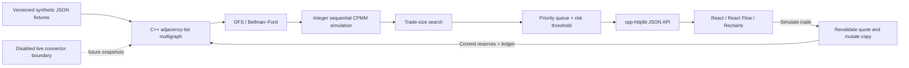

# Architecture and API

## System boundary

The frontend formats numbers for display, plots backend samples and animates backend traces. It never computes quotes, profits, optimal amounts, ledger P&L, exchange rates or arbitrage paths. Decimal financial amounts cross the API as strings; floats are used only for derived visualization values such as ROI, impact and timings.

## Components

`Graph` owns token, pool and directed edge vectors plus hash indexes and adjacency lists. Read-only accessors prevent external mutation from invalidating indexes. Each pool yields `pool-id:ab` and `pool-id:ba`; both directions reference one shared reserve state. Reserve mutation validates both reserves and the fee before updating. Construction rejects duplicate IDs, unknown tokens and unsupported pool types.

`PoolModel` is the pricing interface. `ConstantProduct` is the only enabled model. It computes exact rounded output, derives descriptive rates, and applies input/withdrawal amounts to the pool. It never claims to implement a named Solana protocol.

`DFSDetector` emits reproducible traversal events. `BellmanFord` emits weights, relaxations, distance snapshots and extracted cycles. `SwapSimulator` validates route continuity, unique internal vertices and pools, then applies swaps sequentially to a graph copy. `TradeOptimizer` samples investment sizes and retains the best net result. `RiskManager` sets explicit synthetic costs and the minimum profit threshold.

`ArbitrageEngine` owns the session, fixtures, snapshot revisions, detection IDs, exact evaluations and local ledger. Revisions identify market changes. Each detection also gets a new run ID, so previously displayed opportunities cannot execute accidentally against changed configuration. Simulation revalidates the quote, applies all swaps to a copy, commits the result, records exact balances/profit, then reruns discovery. Execution cannot happen in replay mode.

The server protects engine operations with one mutex. This is intentional single-user consistency rather than a high-throughput architecture. Exceptions become structured JSON errors. It binds to 127.0.0.1 and has a 16 KiB request-body limit. It has no authentication and must not be publicly exposed.

## Contracts

Success: `{"ok":true,"data":...}`. Failure: `{"ok":false,"error":{"code":"INVALID_REQUEST","message":"..."}}`. Validation and malformed JSON return 400, unknown endpoints return 404, unexpected internal errors return 500. Unknown opportunity IDs are validation errors (400).

All POST requests use `Content-Type: application/json`. Monetary/reserve fields must be decimal **strings**, never JSON numbers. Fees and hop counts are integers.

| Endpoint | Request / result |
|---|---|
| GET `/api/health` | Engine status, language, liveConnected=false |
| GET `/api/state` | Atomic full dashboard snapshot: graph, opportunities, candidates, ledger, metrics, configuration |
| GET `/api/scenarios` | IDs, names and descriptions |
| POST `/api/scenario/select` | `{"scenario":"profitable"}` → full state; clears ledger |
| POST `/api/reset` | `{}` → default scenario/configuration, empty ledger |
| GET `/api/graph` | tokens, pools, directed edges, snapshot, synthetic flag |
| GET `/api/opportunities` | Ranked profitable opportunities |
| GET `/api/opportunities/:id` | Candidate detail including exact hops and profit curve |
| POST `/api/detect` | `{"capital":"1000","maxHops":4,"algorithm":"dfs","ranking":"profit"}` → state |
| POST `/api/pools/update` | `{"id":"gamma-jup-usdc","reserveA":"100000","reserveB":"100000","feeBps":30}` → state |
| POST `/api/simulate-trade` | `{"id":"current opportunity id"}` → simulated ledger entry |
| GET `/api/trades` | Session ledger, including backend cumulativePnl |
| GET `/api/algorithm/trace` | algorithm and ordered `steps` |
| GET `/api/benchmarks` | Actual measured dataset results |
| POST `/api/replay` | `{"index":0}` through `3` → synthetic frame and recalculation |
| POST `/api/live/connect` | Explicit disabled-connector error |

Algorithms: `dfs`, `bellman-ford`. Ranking: `profit`, `roi`, `cost`, `hops`. Default max hops 4; supported 2–6. Financial fields: input/output/gross/cost/net in starting-token units; hop fee in source-token units. Each opportunity includes exact `edges`, `pools`, ordered `route`, `hops`, source snapshot, status, sampled `profitCurve` and an `atCapital` evaluation when feasible. Ranked opportunities include full-run `detectionMs`; this is not per-route latency.

DFS steps contain action, start, current, depth, visited and path. Actions are visit/cycle/backtrack. Bellman–Ford steps contain weight or relax/negative-cycle actions, edge ID, iteration, distance map and extracted path as appropriate. Nonfinite initial distances are JSON null.

## Lifecycle and persistence

All state is local and in-memory. Selecting a scenario clears the ledger; entering replay preserves it but prevents mutation. Reset Demo also restores configuration. IDs/timestamps and measured timings are not identical after reset, but routes, quote amounts and traversal ordering are deterministic. Snapshot JSON is read from disk, never downloaded at runtime.

A future connector must emit validated immutable graph snapshots, slot/version metadata and explicit stale-state information. It must not reuse the synthetic fixtures as a substitute for real live data. See the roadmap before adding RPC or any executor.
